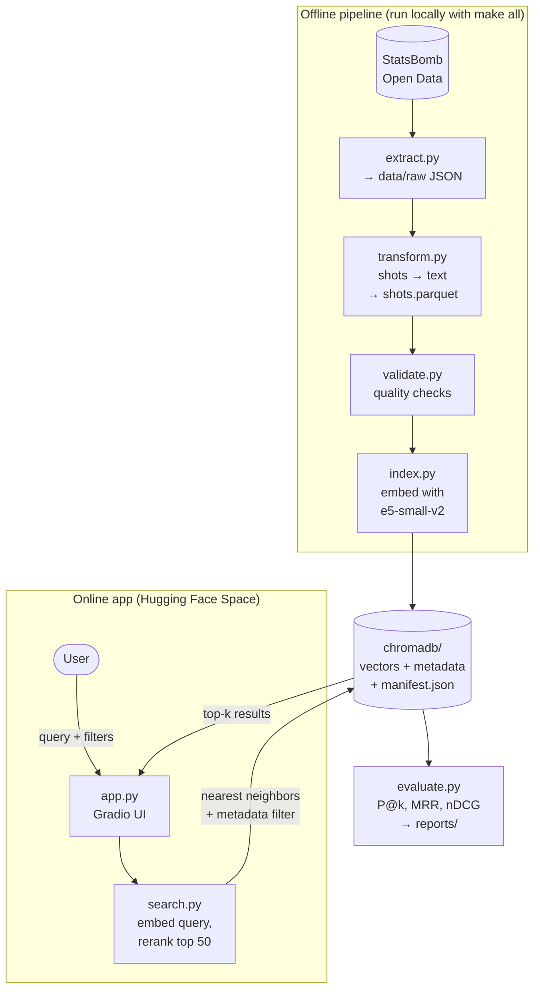
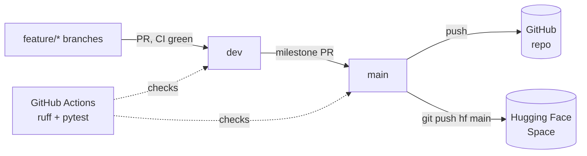

# Football Moments Search

Search 8,821 shots from six international tournaments in plain English, like
"headed goal from a corner in extra time" or "penalty saved by the goalkeeper".

**Live demo:** https://huggingface.co/spaces/alexalber/football-moments-search

[](https://github.com/albertogomezsoteres/semantic-search-app/actions/workflows/ci.yml)

[](https://huggingface.co/spaces/alexalber/football-moments-search)


## What it does

Football event data is structured: every shot has a location, a body part, an outcome, and so on.
This project turns each shot into a short written description, stores those descriptions as
embeddings (lists of numbers that capture the meaning of a text) in a Chroma vector database,
and lets you search them by meaning instead of by keywords. Filters for tournament, team,
goals only, and xG (expected goals: how likely a shot was to go in) narrow the results.

Try searches like (tick "Goals only" for the goal searches):

- "headed goal from a corner"
- "long-range shot into the top corner"
- "first-time volley after a cross"
- "penalty saved by the goalkeeper"
- "Messi penalty in the final"

## Architecture



- **extract** downloads raw JSON from StatsBomb at one pinned commit, skipping files it already has.
- **transform** flattens each shot, adds features (zone, game phase, assist type, running score), and writes the text descriptions to a Parquet file.
- **validate** runs data quality checks and stops the pipeline if any fail.
- **index** embeds every shot and stores vectors, text, and metadata in Chroma, plus a `manifest.json` that records exactly what went in.
- **evaluate** scores search quality on test queries and writes `reports/`.
- **app.py** is a thin Gradio UI; all search logic lives in `src/football_search/search.py`, which the evaluation also uses.



## Data

All data comes from [StatsBomb Open Data](https://github.com/statsbomb/open-data), pinned to
commit `4b73468`. It covers 346 matches and 8,821 shots, penalty shootouts included:

| Tournament | Matches | Shots |
|---|---|---|
| FIFA World Cup 2018 | 64 | 1,706 |
| FIFA World Cup 2022 | 64 | 1,494 |
| UEFA Euro 2020 | 51 | 1,289 |
| UEFA Euro 2024 | 51 | 1,340 |
| Women's World Cup 2019 | 52 | 1,314 |
| Women's World Cup 2023 | 64 | 1,678 |

The data is free for non-commercial use under the StatsBomb Public Data User Agreement.

<a href="https://github.com/statsbomb/open-data"></a>

## How it works

- **One shot is one document.** A shot is a complete event, so there is nothing to split. This is the chunking strategy.
- **Text from structured data.** Each shot becomes a sentence like "Lionel Messi (Argentina) found the net with a first-time right-footed half-volley from inside the six-yard box... It was a rebound after an earlier shot." The full description (with match, minute, and score) is shown in the app.
- **What gets embedded matters most.** The first version embedded the full description, but every shot in a match shares the same opening ("FIFA World Cup 2022, Final: Argentina vs France..."), so shots from one match looked alike to the model. Embedding a shorter "moment" text about only the action clearly improved search (on the test queries, MiniLM went from 0.09 to 0.26 nDCG@10, and e5-small from 0.23 to 0.32). This matches the course point that in retrieval, the data layer is the bottleneck, not the model.
- **Two-stage search.** Chroma finds the 50 nearest shots by cosine similarity (HNSW approximate nearest-neighbor search). A small cross-encoder then rereads the query next to each candidate and reorders them. It is much better at details like "scored" versus "missed".
- **Hybrid search.** Filters on tournament, team, goals, and xG are passed to Chroma as metadata conditions, so semantic search and structured filtering work together.
- **Storage choices.** Raw JSON lands untouched (a staging layer, so a broken transform can be rerun without downloading again), then Parquet for the tabular data, then Chroma for similarity search. The Stats tab runs DuckDB SQL over the same data.
- **Reproducibility.** `config.yaml` pins the data commit and every model revision. The manifest records row counts, a content hash, the models, and library versions. `make all` rebuilds everything.
- **Data quality.** Checks cover required fields, value ranges, unique IDs, text length, and plausible shot counts. Goals counted from shot events (plus own goals) match the final score in all 346 matches. Full report: [`reports/data_quality.md`](reports/data_quality.md).

## Results

Relevance labels come for free from the structured data: each test query has a rule (for
example, "spot kick that the keeper stopped" means penalty and saved), and every matching shot
counts as correct. Queries are written the way a fan might type them, not copied from the
templates. A dev set was used to choose the setup; a separate test set was written before any
tuning and only used for the final numbers.

Test queries, all 8,821 shots (nDCG@10 rewards putting correct shots near the top; 1.0 is perfect):

| Setup | P@10 | MRR | nDCG@10 | Latency |
|---|---|---|---|---|
| MiniLM, full text, no reranker (starter baseline) | 0.08 | 0.17 | 0.09 | 7 ms |
| e5-small, moment text, no reranker | 0.28 | 0.41 | 0.32 | 9 ms |
| **e5-small, moment text, MiniLM reranker (deployed)** | **0.34** | **0.51** | **0.40** | 95 ms |
| Random ranking | 0.01 | 0.04 | 0.01 | - |

The deployed setup won on the dev queries among options under a 300 ms latency budget. The
comparison of 4 embedding models, 3 text templates, and 3 reranker options is in
[`reports/model_selection_wc2022.md`](reports/model_selection_wc2022.md); final numbers are in
[`reports/eval.md`](reports/eval.md).

## Run it locally

```bash
make setup   # create .venv and install dependencies
make all     # download data, transform, validate, index, evaluate
make app     # open the app at http://127.0.0.1:7860
make test    # run the tests (no network needed)
```

## Project structure

```
├── app.py               # Gradio UI (thin)
├── config.yaml          # data commit, competitions, models, settings
├── chromadb/            # prebuilt index + manifest.json (Git LFS)
├── eval/queries.yaml    # dev and test queries with relevance rules
├── reports/             # data quality and evaluation results
├── src/football_search/
│   ├── extract.py  transform.py  validate.py   # data pipeline
│   ├── index.py  embeddings.py  search.py      # vector index and search
│   ├── evaluate.py                             # retrieval metrics
│   └── stats.py                                # DuckDB SQL summaries
├── tests/               # pytest, offline fixtures
└── Makefile
```

## Limitations and next steps

- Embeddings find the right kind of shot (header, volley, chip) much better than the outcome: "headed goal" also returns missed headers. The "Goals only" filter fixes this in the app; a query parser that sets filters from the text would be a good next step.
- Relevance rules are strict: a missed header counts as wrong for "headed goal", even if it is a close match. Real scores for users are likely higher than the table shows.
- Small models still mix up some football slang ("pull-back", "bicycle kick"). A model fine-tuned on football text, or adding keyword search alongside embeddings, would help.
- Only shots are indexed, and placement uses height and distance from the post, not left or right.

## License and credits

Code: MIT (see [LICENSE](LICENSE)). Data: [StatsBomb Open Data](https://github.com/statsbomb/open-data),
used under the StatsBomb Public Data User Agreement.
